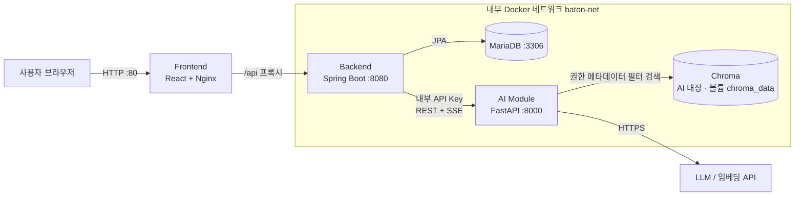
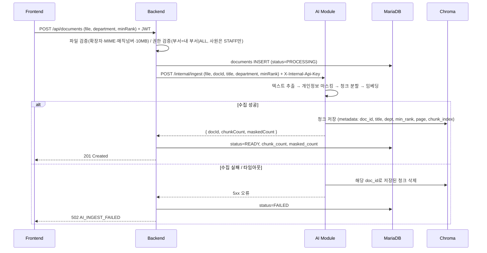
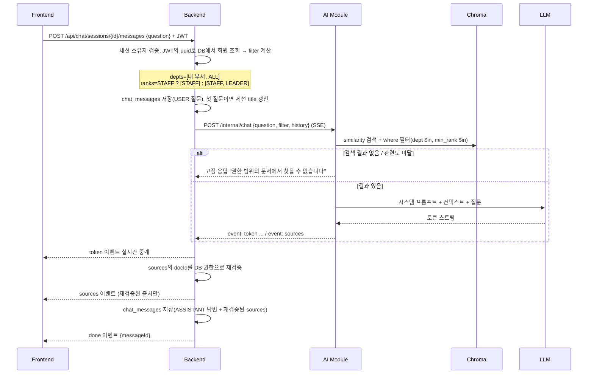

# 시스템 아키텍처 설계서

> 문서 상태: 초안 v0.1 (2026-11-05) · 산출물 2/9

## 1. 시스템 개요

### 1.1 주요 컴포넌트

| 컴포넌트 | 역할 | 외부 공개 |
|----------|------|-----------|
| Frontend (React + Nginx) | 화면 4개 제공, `/api/*`를 Backend로 리버스 프록시 | **공개 (80)** |
| Backend (Spring Boot) | 인증·인가, 문서 메타데이터, 권한 필터 조건 생성, AI 호출·SSE 중계, 대화 이력 | 비공개 (Nginx 경유) |
| AI Module (FastAPI + LangChain) | 문서 수집(마스킹·분할·임베딩), 권한 필터 검색, 답변 생성(SSE) | 비공개 |
| MariaDB | 계정, 문서 메타데이터, 대화 이력, Refresh Token 해시 | 비공개 |
| Chroma | 문서 청크 벡터 + 메타데이터(doc_id, title, dept, min_rank, page, chunk_index). AI Module 컨테이너 안에서 내장 실행(PersistentClient) | 비공개 (별도 포트 없음) |

## 2. 시스템 구성도



- Frontend는 AI Module을 직접 호출하지 않는다. 모든 요청은 Backend를 거친다.
- EC2 보안그룹은 80(서비스), 22(팀 IP 한정)만 연다. 8080·8000·3306은 Compose에서 `ports` 미게시. Chroma는 AI Module 내장이라 포트가 없다.

## 3. 기술 스택

| 구분 | 기술 | 버전 |
|------|------|------|
| Frontend | React, Vite, React Router, Zustand, Tailwind CSS, Nginx | React 18 / Node 20 LTS |
| Backend | Java, Spring Boot, Spring Security, Spring Data JPA, WebClient, Flyway | Java 17 / Spring Boot 3.x |
| AI/ML | Python, FastAPI, LangChain(LCEL), langchain-chroma | Python 3.11 |
| LLM | LLM 1종 + 임베딩 1종 (OpenAI / Gemini / Upstage 중) | Day 1 확정 |
| Database | MariaDB, Chroma | MariaDB 11.x |
| Infra | Docker, Docker Compose, GitHub Actions, AWS EC2 (선택: Minikube) | — |

## 4. 컴포넌트 구조

```
baton-secure-handover/
├── frontend/          # C
├── backend/           # A(auth, security), B(document, chat, ai)
├── ai-module/         # D(api, ingest), E(rag, prompts, guard)
├── infra/             # F (docker-compose, nginx, seed)
├── .github/workflows/ # F
└── docs/              # 총괄, 각자 담당 문서
```

### 4.1 Frontend
- `src/pages/` — `LoginPage`, `DocumentsPage`, `ChatPage` (업로드는 `DocumentsPage` 안의 모달)
- `src/components/` — `DocumentTable`, `UploadModal`, `ChatSidebar`, `ChatMessage`, `SourceChip`, `LoadingSpinner`
- `src/stores/` — `authStore`(Access Token·내 정보, 메모리 보관), `chatStore`
- `src/services/` — `apiClient`(401 시 재발급), `documentApi`, `chatApi`(fetch 스트림으로 SSE 수신)
- `src/routes/` — `ProtectedRoute`

### 4.2 Backend (`com.baton`)
- `auth/` — `AuthController`, `AuthService`, `JwtProvider`, `RefreshTokenService`, `LoginAttemptService` (A)
- `security/` — `SecurityConfig`, `JwtAuthenticationFilter`, `AuditLogger`, `GlobalExceptionHandler` (A)
- `member/` — `Member`, `MemberRepository`, `Department`, `Rank` enum (A)
- `document/` — `DocumentController`, `DocumentService`, `DocumentRepository`, `FileValidator`, `AccessPolicy` (B)
- `chat/` — `ChatController`, `ChatService`, `ChatSession`, `ChatMessage` (B)
- `ai/` — `AiClient`(WebClient), `AiFilter`, DTO (B)
- `resources/db/migration/` — `V1__init.sql`, `V2__seed_members.sql` (B)

### 4.3 AI Module (`ai-module/app`)
- `api/` — `main.py`, `routes_ingest.py`, `routes_chat.py`, `deps.py`(내부 API Key 검증) (D)
- `ingest/` — `loader.py`(PDF·DOCX), `pii_masker.py`, `splitter.py`, `indexer.py` (D)
- `rag/` — `retriever.py`(권한 필터), `chain.py`(LCEL) (E)
- `prompts/` — `system_prompt.py` (E)
- `guard/` — `injection_filter.py`, `output_check.py` (E)

## 5. 데이터 플로우

### 5.1 문서 업로드



- 원본 파일은 저장하지 않는다(마스킹 전 개인정보 보관 방지). 삭제 시 DB 행과 Chroma 청크를 함께 지운다.
- `FAILED` 행은 `status = 'READY'` 조건 때문에 목록·검색·채팅 어디에도 나타나지 않는다.

### 5.2 권한 필터 AI 채팅



## 6. 보안 아키텍처

> 상세 점검 결과는 `9. 보안점검서.md`에 작성한다. 여기서는 구조적 보안 설계만 기술한다.

### 6.1 신뢰 경계(Trust Boundary)

| 경계 | 구간 | 통제 |
|------|------|------|
| TB1 | 인터넷 ↔ Frontend(Nginx) | 보안그룹 80만 공개, CSP·보안 헤더, (선택) HTTPS |
| TB2 | Frontend ↔ Backend | JWT(Authorization 헤더), CORS Origin 한정, 입력 검증 |
| TB3 | Backend ↔ AI Module | Docker 내부 네트워크 전용, `X-Internal-Api-Key`, 권한 필터는 Backend만 생성 |
| TB4 | AI Module ↔ LLM API | 컨텍스트에 권한 범위 청크만 포함, 마스킹된 텍스트만 전송 |
| TB5 | Backend/AI ↔ MariaDB/Chroma | 내부 네트워크 전용, 앱 전용 DB 계정 |

### 6.2 인증·인가
- 인증: 회원가입 없음, 시드 계정 로그인 → Access Token(30분, Authorization 헤더) + Refresh Token(7일, HttpOnly·Secure·SameSite=Strict 쿠키, `path=/api/auth`). JWT subject는 member `uuid`.
- Refresh Token은 DB에 SHA-256 해시로 저장, 재발급 시 교체(rotation)·로그아웃 시 폐기.
- 로그인 실패 5회 → 15분 잠금(`members.locked_until`).
- 인가
  - 문서: `AccessPolicy.canRead(member, doc)` = 부서 규칙 AND 직급 규칙. 권한 없는 문서는 **404**로 응답(존재 여부 숨김).
  - 문서 삭제: 업로더 본인만.
  - 채팅 세션·메시지: 세션 소유자만.
  - RAG: 권한 필터는 Backend가 JWT 클레임 값이 아니라, JWT의 uuid로 DB에서 회원을 조회한 뒤 계산해 AI에 전달. 요청 본문의 부서·직급 값은 받지 않는다.
- Backend ↔ AI: 공유 비밀 `AI_INTERNAL_API_KEY` 헤더 검증, AI 포트 미공개.
- CSRF: API는 헤더 JWT 방식이라 CSRF 비활성. 쿠키를 쓰는 `/api/auth/refresh`는 SameSite=Strict + POST 전용으로 보호(근거를 보안점검서에 기재).

### 6.3 보안 설계 원칙 적용 내역

| 원칙 | 우리 시스템에서의 적용 |
|------|------------------------|
| Defense in Depth | 보안그룹(80) → JWT 필터 → 서비스 계층 `AccessPolicy` → Chroma `where` 필터 → 출처 docId DB 재검증 |
| Least Privilege | 앱 전용 DB 계정(`baton_app`), Actuator `health`만 노출, AI Module은 Backend만 호출, 사원은 팀장 전용 문서 업로드 불가 |
| Secure by Default | `anyRequest().authenticated()`, CORS Origin 한정, `ddl-auto: validate`, 검색 결과 없으면 LLM 미호출 |
| Never Trust Input | DTO `@Valid`, 파일 매직넘버 검사, 경로 ID 권한 확인, 질문 길이 제한(1,000자), 문서 내 지시문은 데이터로만 취급 |
| Data Minimization | 원본 파일 미보관, 임베딩 전 개인정보 마스킹, 감사 로그 이메일 마스킹 |

### 6.4 비밀정보 관리
- 관리 대상: `JWT_SECRET_KEY`, `DB_PASSWORD`, `LLM_API_KEY`, `AI_INTERNAL_API_KEY`, Docker Hub 토큰, EC2 SSH 키
- 로컬: `.env`(Git 제외) + `.env.example`(빈 값) 제공
- CI/CD: GitHub Secrets → Actions에서 주입, EC2에서는 서버에만 존재하는 `.env`
- (선택) K8s: Secret / ConfigMap 분리
