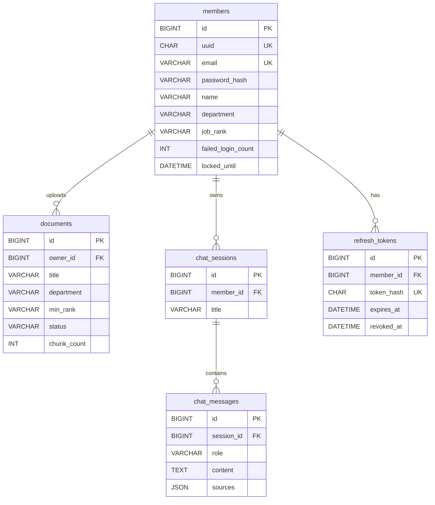

# 데이터베이스 설계서

> 문서 상태: v0.4 (2026-11-08) · 산출물 3/9 · 작성: B 황지영

## 1. 데이터베이스 구성

- **RDBMS**: MariaDB 11.x — DB명 `baton_db`, 앱 전용 계정 `baton_app` (root 사용 금지)
- **스키마 관리**: Flyway (`backend/src/main/resources/db/migration`), JPA `ddl-auto=validate`
- **Vector DB**: Chroma — 컬렉션 `baton_docs`
- 문자셋: `utf8mb4` / `utf8mb4_unicode_ci`
- **시각 컬럼**: 모두 DATETIME(6) / 기본값 CURRENT_TIMESTAMP(6) — Hibernate LocalDateTime 기본 정밀도(마이크로초)와 일치

## 2. ERD



## 3. 주요 테이블

### 3.1 members (계정) — 회원가입 없음, Flyway 시드
| 컬럼명 | 타입           | 제약조건 | 설명 |
|--------|--------------|----------|------|
| id | BIGINT       | PK, AUTO_INCREMENT | 내부 ID |
| uuid | CHAR(36)     | UNIQUE, NOT NULL | JWT subject (외부 노출 식별자) |
| email | VARCHAR(100) | UNIQUE, NOT NULL | 로그인 ID |
| password_hash | VARCHAR(100) | NOT NULL | BCrypt 해시 |
| name | VARCHAR(30)  | NOT NULL | 표시 이름 |
| department | VARCHAR(10)  | NOT NULL, CHECK IN ('SALES','DEV') | 소속 부서 |
| job_rank | VARCHAR(10)  | NOT NULL, CHECK IN ('STAFF','LEADER') | 직급 (`rank`는 예약어라 `job_rank`) |
| failed_login_count | INT          | NOT NULL, DEFAULT 0 | 연속 실패 횟수 |
| locked_until | DATETIME(6)  | NULL | 잠금 해제 시각 (5회 실패 → +15분) |
| created_at | DATETIME(6)     | NOT NULL | 생성일 |

### 3.2 documents (문서 메타데이터) — 원본 파일은 보관하지 않음
| 컬럼명 | 타입 | 제약조건 | 설명 |
|--------|------|----------|------|
| id | BIGINT | PK, AUTO_INCREMENT | 문서 ID |
| owner_id | BIGINT | FK → members.id, NOT NULL | 업로더 |
| title | VARCHAR(200) | NOT NULL | 문서명 (기본값: 원본 파일명에서 확장자 제거) |
| original_filename | VARCHAR(255) | NOT NULL | 원본 파일명 (정제 후 저장, 화면 출력 시 이스케이프) |
| file_type | VARCHAR(10) | NOT NULL, CHECK IN ('PDF','DOCX') | 형식 |
| file_size | BIGINT | NOT NULL | 바이트 (≤ 10MB) |
| department | VARCHAR(10) | NOT NULL, CHECK IN ('SALES','DEV','ALL') | 열람 부서 |
| min_rank | VARCHAR(10) | NOT NULL, CHECK IN ('STAFF','LEADER') | 공개 직급 |
| status | VARCHAR(12) | NOT NULL | PROCESSING / READY / FAILED |
| chunk_count | INT | NOT NULL, DEFAULT 0 | Chroma 청크 수 |
| masked_count | INT | NOT NULL, DEFAULT 0 | 마스킹된 개인정보 건수 |
| created_at | DATETIME(6) | NOT NULL | 작성일 |

인덱스: `idx_documents_access (department, min_rank, status)` — 권한 필터 조회, `idx_documents_owner (owner_id)` — 업로더 FK 조회

### 3.3 chat_sessions (대화)
| 컬럼명 | 타입 | 제약조건 | 설명 |
|--------|------|----------|------|
| id | BIGINT | PK, AUTO_INCREMENT | 세션 ID |
| member_id | BIGINT | FK → members.id, NOT NULL | 소유자 |
| title | VARCHAR(100) | NOT NULL, DEFAULT '새 대화' | 생성 시 '새 대화', 첫 질문 저장 시 질문 앞 30자로 갱신 |
| created_at | DATETIME(6) | NOT NULL | |
| updated_at | DATETIME(6) | NOT NULL | 목록 정렬 기준 (메시지 저장 시 갱신) |

인덱스: `idx_chat_sessions_member (member_id, updated_at)` — 내 대화 목록 최신순

### 3.4 chat_messages (대화 메시지)
| 컬럼명 | 타입 | 제약조건 | 설명 |
|--------|------|----------|------|
| id | BIGINT | PK, AUTO_INCREMENT | 메시지 ID |
| session_id | BIGINT | FK → chat_sessions.id, NOT NULL, ON DELETE CASCADE | 세션 |
| role | VARCHAR(10) | NOT NULL, CHECK IN ('USER','ASSISTANT') | 발화자 |
| content | TEXT | NOT NULL | 질문 또는 답변 |
| sources | JSON | NULL | `[{"docId":3,"title":"거래처 관리 매뉴얼","page":2}]` (재검증된 출처만, DOCX는 `page: null`) |
| created_at | DATETIME(6) | NOT NULL | |

인덱스: `idx_chat_messages_session (session_id, id)` — 이력 시간순 조회

### 3.5 refresh_tokens
| 컬럼명 | 타입 | 제약조건 | 설명 |
|--------|------|----------|------|
| id | BIGINT | PK, AUTO_INCREMENT | |
| member_id | BIGINT | FK → members.id, NOT NULL | |
| token_hash | CHAR(64) | UNIQUE, NOT NULL | SHA-256 해시 (원문 미저장) |
| expires_at | DATETIME(6) | NOT NULL | 만료 |
| revoked_at | DATETIME(6) | NULL | 폐기 시각 (재발급·로그아웃) |
| created_at | DATETIME(6) | NOT NULL | |

## 4. 관계

- members (1:N) documents — 업로더
- members (1:N) chat_sessions — 대화 소유자
- chat_sessions (1:N) chat_messages — `@OneToMany(mappedBy, cascade=ALL, orphanRemoval=true)`
- members (1:N) refresh_tokens
- 모든 `@ManyToOne`은 `FetchType.LAZY`

## 5. 권한 판정 규칙 (DB·Vector DB 공통)

```
canRead(member, doc) =
    (doc.department = 'ALL' OR doc.department = member.department)
AND (doc.min_rank = 'STAFF' OR member.job_rank = 'LEADER')
AND doc.status = 'READY'
```

문서함 조회 JPQL(파라미터 바인딩):

```sql
SELECT d FROM Document d
WHERE d.status = 'READY'
  AND d.department IN (:myDept, 'ALL')
  AND d.minRank IN (:allowedRanks)
  AND (:keyword IS NULL OR d.title LIKE CONCAT('%', :keyword, '%'))
```

## 6. 시드 데이터 (Flyway `V2__seed_members.sql`)

| email | name | department | job_rank |
|-------|------|------------|----------|
| sales.staff@baton.local | 김영업 | SALES | STAFF |
| sales.lead@baton.local | 박영업 | SALES | LEADER |
| dev.staff@baton.local | 이개발 | DEV | STAFF |
| dev.lead@baton.local | 최개발 | DEV | LEADER |

- `name`에는 직급을 넣지 않는다. 화면의 "작성자(직급)"는 `name` + `job_rank`로 조합한다.
- 비밀번호는 BCrypt 해시로만 시드 파일에 저장. 평문 시연 비밀번호는 Git에 넣지 않고 팀 내부로만 공유.
- 예시 문서 10개는 임베딩이 필요하므로 SQL이 아니라 `infra/seed/upload_samples.sh`가 업로드 API로 등록한다. (각 문서를 해당 권한의 계정으로 업로드)
- 스크립트는 로그인에 필요한 시연 비밀번호를 환경변수 `SEED_PASSWORD`(`.env`, Git 제외)에서 읽는다. 스크립트·Git에 평문을 적지 않는다.

| 권한 그룹 | 업로드 계정 | 문서 |
|-----------|-------------|------|
| ALL·STAFF | 영업 사원 / 개발 사원 | 사내 복리후생 안내, 비품 구매 절차 |
| SALES·STAFF | 영업 사원 | 거래처 관리 매뉴얼, 월간 영업보고 작성법 |
| SALES·LEADER | 영업 팀장 | 거래처 계약 단가표, 영업팀 성과평가 기준 |
| DEV·STAFF | 개발 사원 | 개발 환경 세팅 가이드, 배포 절차서 |
| DEV·LEADER | 개발 팀장 | 서버 접근권한 관리 정책, 외주 개발 계약 현황 |

## 7. 벡터 DB 설정 (Chroma)

- **실행 방식**: AI Module 안에서 `PersistentClient`로 내장 실행 (별도 컨테이너·포트 없음)
- **컬렉션**: `baton_docs` / 저장 경로 `VECTOR_STORE_PATH=/data/chroma/<임베딩 모델명>` → 영속 볼륨 `chroma_data`(`/data/chroma`)에 마운트
- **임베딩 모델 / 벡터 차원**: 개발 Ollama bge-m3 1024차원 / 배포 OpenAI text-embedding-3-large 3072차원 (배포는 `dimensions`를 지정하지 않으면 기본값 3072)
- **청크 크기**: 800자 / **오버랩**: 150자 (`RecursiveCharacterTextSplitter`, 한글 문서 기준 조정 가능)
- **검색**: similarity, k=4, 관련도 임계값 미달 시 "찾을 수 없음" 처리
- **청크 메타데이터**

| 키 | 예시 | 용도 |
|----|------|------|
| doc_id | 3 | 삭제·출처 재검증 |
| title | 거래처 관리 매뉴얼 | 출처 칩 표시 |
| dept | SALES | 권한 필터 |
| min_rank | STAFF | 권한 필터 |
| page | 2 | 출처 페이지 (DOCX는 페이지가 없어 키를 넣지 않음 → 출처 응답에서 `null`) |
| chunk_index | 5 | 디버깅 |

- **검색 필터 변환**: Backend는 `filter: {"departments": [...], "ranks": [...]}`만 보낸다(4장 6.2절). AI는 이 값을 아래 Chroma `where` 조건으로 **변환**해 적용하며, Backend가 Chroma 문법을 직접 보내지 않는다.

```json
{ "departments": ["SALES", "ALL"], "ranks": ["STAFF"] }
```
↓ AI에서 변환

```json
{ "$and": [
    { "dept":     { "$in": ["SALES", "ALL"] } },
    { "min_rank": { "$in": ["STAFF"] } }
] }
```

- 수집 실패·같은 docId 재수집 시 `collection.delete(where={"doc_id": id})`

## 변경 이력

| 버전   | 날짜         | 작성자 | 변경 내용 |
|------|------------|--------|-----------|
| v0.1 | 2026-11-05 | B 황지영 | 초안 작성 |
| v0.2 | 2026-11-06 | B 황지영 | 설계서 1~4 정합성 수정 |
| v0.3 | 2026-11-07 | B 황지영 | `documents.updated_at` 제거, 채팅 인덱스 2개 기재, Chroma 저장 경로·임베딩 차원 기입, 문서 삭제 제외 반영, 양식 통일 |
| v0.4 | 2026-11-08 | B 황지영 | 시각 컬럼 DATETIME(6)·CURRENT_TIMESTAMP(6)로 변경 |
| v0.5 | 2026-11-11 | C 이원구 | 임베딩 모델을 text-embedding-3-large로 변경 반영(개발·배포 공통, 3072차원) |
| v0.6 | 2026-11-11 | C 이원구 | 임베딩 모델 정정: 개발은 Ollama bge-m3(1024차원) 유지, 배포만 text-embedding-3-large(3072차원) |
