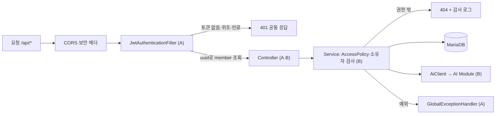
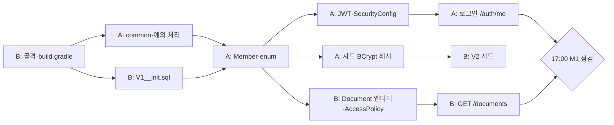

# Backend 개발명세서

> 문서 상태: 초안 v0.1 (2026-11-06) · 산출물 5/9 · 작성: A(인증·보안), B(도메인·AI 연동)
> 기준 문서: `0.개발일정표.md`, `1.프로젝트계획서.md`, `2.시스템아키텍처설계서.md`, `3.데이터베이스설계서.md`, `4.API설계서.md`, `7. AI모듈연동명세서.md`, `8.컨테이너배포초안.md`

## 1. 문서 개요

### 1.1 목적
- Backend(`backend/`)를 함께 만드는 **A·B가 무엇을 따로 만들고, 무엇을 같이 정해야 하는지** 한 곳에 정리한다.
- Backend가 언제 무엇을 넘겨야 **C(FE)·D·E(AI)·F(DevOps)가 막히지 않는지** 핸드오프 기준을 정한다.
- API 요청·응답 형식은 `4.API설계서.md`, AI 내부 API는 `7. AI모듈연동명세서.md`를 따른다. 이 문서는 **구조·소유권·순서**만 다룬다.

### 1.2 범위
| 포함 | 제외 |
|------|------|
| 패키지 구조와 소유자, A·B 공통 합의 사항, 요청 처리 흐름, 설정·환경변수, 일정·핸드오프 | API 필드 상세(4번), 테이블 컬럼 상세(3번), AI 내부 동작(7번), 보안 점검 결과(9번) |

## 2. 담당 및 소유권

| 담당 | 이름 | Backend 내 역할 | 소유 패키지·파일 |
|------|------|-----------------|------------------|
| A | 정현준 | 인증·인가 틀, 토큰, 잠금, 감사 로그, 보안 헤더, 공통 응답·예외 | `auth/`, `security/`, `member/`, `common/`, `application.yml` |
| B | 황지영 | 문서함·채팅 도메인, 권한 필터 조건, AI 연동·SSE 중계, 스키마 | `document/`, `chat/`, `ai/`, `db/migration/`, `build.gradle` |

- 남의 패키지 변경은 **소유자 승인 PR로만** 한다(계획서 7장).
- A 부재(11/7~8) 동안 A 소유 파일은 **B가 대리 리뷰**, 버그 수정만 허용하고 11/9 A가 사후 리뷰한다(일정표 3.1).

## 3. 폴더 구조

```
backend/
├── build.gradle                 # B — 의존성·플러그인 (SBOM용 CycloneDX 포함)
├── settings.gradle              # B
├── gradlew, gradle/wrapper/     # B — Dockerfile이 ./gradlew로 빌드
├── Dockerfile                   # F
└── src/
    ├── main/
    │   ├── java/com/baton/
    │   │   ├── BatonApplication.java
    │   │   ├── common/          # A — 모두가 쓰는 공통 응답·예외·시간 컬럼
    │   │   ├── security/        # A — 필터 체인, JWT 필터, 보안 헤더, 감사 로그
    │   │   ├── auth/            # A — 로그인·재발급·로그아웃·잠금
    │   │   ├── member/          # A — 계정 엔티티와 부서·직급 enum
    │   │   ├── document/        # B — 문서함·업로드·권한 판정
    │   │   ├── chat/            # B — 대화 세션·메시지·SSE 중계
    │   │   └── ai/              # B — AI 모듈 호출(WebClient)·권한 필터 생성
    │   └── resources/
    │       ├── application.yml  # A — 값은 모두 환경변수로 주입
    │       └── db/migration/    # B — Flyway V1(스키마)·V2(시드 계정)
    └── test/java/com/baton/     # 각자 소유 패키지와 같은 경로에 테스트
```

### 3.1 패키지별 기능

| 패키지 | 소유 | 주요 클래스 | 기능 |
|--------|------|-------------|------|
| `common` | A | `ApiResponse`, `ErrorCode`(interface), `BusinessException`, `BaseTimeEntity` | 공통 응답 형식, 도메인별 오류 코드의 공통 틀, 생성·수정 시각 |
| `security` | A | `SecurityConfig`, `JwtAuthenticationFilter`, `AuthMember`, `AuditLogger`, `GlobalExceptionHandler` | 인증 필터 체인, 401·403 JSON 응답, 현재 사용자 주입, 감사 로그, 예외 → 공통 응답 변환 |
| `auth` | A | `AuthController`, `AuthService`, `JwtProvider`, `RefreshTokenService`, `RefreshToken`, `LoginAttemptService` | 로그인·재발급·로그아웃·내 정보, Refresh 해시 저장·교체, 실패 횟수·잠금 |
| `member` | A | `Member`, `MemberRepository`, `Department`, `Rank` | 시드 계정 조회, 부서(`SALES`·`DEV`·`ALL`)·직급(`STAFF`·`LEADER`) |
| `document` | B | `DocumentController`, `DocumentService`, `Document`, `DocumentRepository`, `FileValidator`, `AccessPolicy` | 문서 목록·상세·업로드·삭제, 업로드 검증, 열람 권한 판정(권한 밖 404) |
| `chat` | B | `ChatController`, `ChatService`, `ChatSession`, `ChatMessage` | 대화 세션 CRUD, 질문 → SSE 중계, 출처 재검증, 이력 저장 |
| `ai` | B | `AiClient`, `AiFilter`, DTO | `/internal/ingest`·`/internal/chat`·`DELETE /internal/documents/{id}` 호출, DB의 member로 권한 필터 생성 |
| `db/migration` | B | `V1__init.sql`, `V2__seed_members.sql` | 테이블 5개·인덱스·CHECK, 시드 계정 4개(BCrypt 해시) |

> `common/` 패키지는 아키텍처 설계서 4.2에 없는 신규 제안이다. 머지되면 아키텍처 설계서에 반영한다.

## 4. A 단독 영역 (인증·보안)

| 항목 | 내용 | 근거 |
|------|------|------|
| JWT | Access 30분, `Authorization: Bearer`, **subject = member `uuid`**, 부서·직급 클레임은 넣지 않음 | 아키텍처 6.2 |
| Refresh Token | 7일, 쿠키 `baton_rt`(HttpOnly·Secure·SameSite=Strict·`Path=/api/auth`), DB에는 **SHA-256 해시만** 저장, 재발급 시 교체, 폐기된 토큰 재사용 시 401 | DB 3.5, API 3.2 |
| 로그인 잠금 | 연속 5회 실패 → 15분 잠금, 401에 `remainingAttempts`, 423에 `lockedUntil` | API 3.1 |
| 감사 로그 | 로그인 성공·실패·잠금, 재발급 실패, 401·403, 권한 밖 접근(404 처리 건) 기록, 이메일 마스킹 | 계획서 5장 |
| 보안 헤더·CORS | CORS는 허용 Origin만, CSRF 비활성(사유 주석), CSP 값 결정 후 F(Nginx)에 전달 | 아키텍처 6.2 |
| Actuator | `health`만 노출, 상세 정보 비공개 | 아키텍처 6.3 |
| 보안점검서 | `9.보안점검서.md` 틀·수합·최종본, Burp(IDOR·Brute Force)·SBOM 직접 수행 | 일정표 Day 4~6 |

## 5. B 단독 영역 (도메인·AI 연동)

| 항목 | 내용 | 근거 |
|------|------|------|
| 문서함 | 목록(검색·페이징·`sort` 화이트리스트), 상세, 삭제(본인만, DB + Chroma 동시) | API 4장 |
| 업로드 검증 | 확장자·MIME·매직넘버·10MB·파일명 정제, 부서·직급 범위 서버 강제(`DOC_FORBIDDEN_SCOPE`) | API 4.2 |
| 권한 판정 | `AccessPolicy.canRead()` — 부서 규칙 AND 직급 규칙 AND `READY`, 권한 밖은 404 | DB 5장 |
| 권한 필터 생성 | `AiFilter.from(member)` → `{departments, ranks}`, 요청 본문 값은 받지 않음 | API 6.2 |
| AI 연동 | WebClient, `X-Internal-Api-Key`, 타임아웃(연결 3초·수집 120초·첫 토큰 30초·전체 120초) | 7번 7장 |
| SSE 중계 | AI의 `token`→`sources`→`done`을 FE에 중계, `sources`는 DB 권한으로 재검증, `done`에 `messageId` 추가 | 7번 4.2 |
| 스키마 | Flyway로만 변경, `ddl-auto=validate` | DB 1장 |

## 6. A·B 공통 영역 (겹치는 부분)

> 아래 항목은 **한 명이 만들고 다른 한 명이 반드시 쓰는** 부분이다. 만드는 사람이 먼저 머지해야 상대가 진행할 수 있다.

| # | 항목 | 만드는 사람 | 쓰는 사람 | 합의 내용 |
|---|------|:---:|:---:|-----------|
| 1 | 프로젝트 골격 (`build.gradle`, wrapper) | B | A | 가장 먼저 머지. Boot 3.x / Java 17, 의존성: Web·Security·JPA·Validation·WebFlux(WebClient)·Actuator·Flyway(+`flyway-mysql`)·MariaDB·Lombok·JJWT 0.12.x·CycloneDX. `jar { enabled = false }`로 plain jar 생성을 막아 Dockerfile의 `*.jar` 복사가 1개만 잡히게 한다 |
| 2 | 공통 응답·예외 (`common/`) | A | B | `ApiResponse.ok(data)` / `fail(code)`. 오류 코드는 **도메인별 enum이 `ErrorCode`를 구현** (`AuthErrorCode`(A), `DocumentErrorCode`·`ChatErrorCode`·`AiErrorCode`(B)) → 한 파일 동시 수정 충돌 방지 |
| 3 | `GlobalExceptionHandler` | A | B | B는 `throw new BusinessException(DocumentErrorCode.DOC_NOT_FOUND)`만 하면 공통 형식으로 응답. 업로드 초과(`MaxUploadSizeExceededException`) → 413 `FILE_TOO_LARGE`, 검증 실패 → 400 `VALIDATION_FAILED`, 그 외 500 `INTERNAL_ERROR`(스택 미노출) |
| 4 | 현재 사용자 (`AuthMember`) | A | B | JWT 필터가 uuid로 **DB에서 member를 조회**해 `AuthMember(id, department, rank)`를 넣는다. B는 `@AuthenticationPrincipal AuthMember me`로 받아 `AccessPolicy`·`AiFilter`에 사용 → "권한 필터는 DB 기준" 원칙 충족 |
| 5 | `Member` 엔티티·enum | A | B | `Document.owner`, `ChatSession.member`가 `Member`를 `LAZY`로 참조. `Department`에는 `ALL` 포함, member 컬럼은 `SALES`·`DEV`만 |
| 6 | Flyway V1·V2 | B | A | `members`·`refresh_tokens` 테이블은 B가 V1에 작성, A가 컬럼명을 엔티티와 대조해 리뷰. V2 시드 해시는 A가 생성해 전달(평문은 팀 채널로만) |
| 7 | `application.yml` | A | B | B가 필요한 키(`ai.*`, 업로드 10MB, 타임아웃)는 A에게 요청해 A가 추가. 값은 모두 환경변수 |
| 8 | 인가 경로 규칙 | A | B | `permitAll`: `/api/auth/login`, `/api/auth/refresh`, `/actuator/health` / 나머지 `authenticated()`. 문서·세션의 **소유자·권한 검사는 서비스 계층(B)**에서 한다 |
| 9 | SSE와 보안 필터 | A·B | — | 비동기 디스패치(`ASYNC`)·`ERROR` 디스패치에서 인증이 다시 실패하지 않도록 `SecurityConfig`에서 처리. 11/8 B의 가짜 SSE로 같이 확인 |
| 10 | 감사 로그 호출 | A | B | B는 권한 밖 접근(404 처리), 타인 문서 삭제 시도(403)에서 `AuditLogger`를 호출 |
| 11 | Rate Limit | B | A | 7번 문서 A-4의 "결정 필요" 항목. 구현할지, 9번 보안점검서 잔여 위험으로 둘지 11/9까지 결정 |

## 7. 요청 처리 흐름



- 인증(누구인가)은 A의 필터, 인가(이 문서·세션을 볼 수 있는가)는 B의 서비스 계층에서 판정한다.
- 권한 밖 리소스는 403이 아니라 **404**로 응답해 존재 여부를 숨긴다. 단, 열람은 가능하지만 본인 문서가 아닌 삭제는 403 `DOC_NOT_OWNER`.

## 8. 다른 파트와의 연결 — Backend가 먼저 해야 하는 것

| Backend가 할 일 | 담당 | 그래야 가능한 다른 파트 작업 | 기한 |
|-----------------|:---:|------------------------------|------|
| 프로젝트 골격 + `gradlew` 머지 | B | F: backend Dockerfile 빌드 확인 | 11/6 |
| `POST /auth/login`·`GET /auth/me`·JWT 필터 머지 | A | C: 로그인 화면 실 API 연동(11/8), F: `upload_samples.sh` 로그인 | 11/6 18:00 |
| `application.yml`에 `ai.*` 키, 환경변수 이름 목록 전달 | A | F: `.env.example`·Compose 정리, D: 내부 API Key 공유 | 11/6 |
| `/actuator/health` 공개 | A | F: Dockerfile `HEALTHCHECK`, Compose `service_healthy` | 11/6 |
| 공통 응답·오류 코드 확정 | A·B | C: `apiClient` 공통 파싱, 오류 코드별 안내 문구 | 11/6 |
| 문서 업로드·목록·삭제 API | B | C: 문서함·업로드 모달 연동, F: 예시 문서 10개 시드 | 11/8 15:00 |
| `AiClient` 실연동 (`filter` 형식 준수) | B | D·E: 권한 필터 RAG 실제 검증 | 11/8 15:00 |
| 가짜 SSE → 실 SSE 중계 | B | C: 채팅 화면 스트리밍·출처 칩 | 11/8 / 11/9 12:00 |
| Refresh·로그아웃·쿠키 속성 | A | C: 새로고침 시 `/auth/refresh` 복구, 401 재발급 처리 | 11/9 |
| CSP·CORS 값 확정 | A | F: Nginx 보안 헤더, C: CSP 위반 여부 확인 | 11/9 |
| 보안점검서 틀 | A | 전원: 각자 점검 결과 기입 | 11/10 |

## 9. 일정 (추천)

> `0.개발일정표.md`의 A·B 항목을 Backend 관점으로 묶은 것이다. A는 11/7~8, B는 11/7 부재.

| 날짜 | A (인증·보안) | B (도메인·AI 연동) | 같이 할 일 |
|------|---------------|--------------------|------------|
| **11/6 (금)** | `common/`·`GlobalExceptionHandler` → `Member`·enum → `JwtProvider`·필터·`SecurityConfig` → 로그인·`/auth/me` → `application.yml`, 시드 해시 전달 | 골격·`build.gradle` → `V1__init.sql` → V2(해시 받은 뒤) → 엔티티·`AccessPolicy`·`AiFilter` → `GET /documents` | 17:00 M1 점검: 로그인 토큰으로 `/auth/me`·`/documents` 호출 / 18:00 A 머지, 주말 대리 리뷰 인계 |
| 11/7 (토) | 부재 | 부재 | backend 머지 없음 |
| 11/8 (일) | 부재 | `FileValidator`·업로드·삭제, `AiClient` 수집 연동, 채팅 세션 API, 가짜 SSE | B가 A 소유 파일 대리 리뷰(버그 수정만) |
| **11/9 (월)** | 주말 PR 사후 리뷰, Refresh(해시·교체·재사용 감지)·로그아웃, 로그인 잠금, 감사 로그, CORS·CSP | 실 SSE 중계(12:00 미완 시 비스트리밍), 출처 재검증, 메시지 저장 | SSE + 보안 필터 동작 확인, Rate Limit 결정 / 18:00 기능 동결 |
| 11/10 (화) | Burp(IDOR·JWT 변조·Brute Force), SBOM, 보안점검서 틀·수합 | SQLi(`keyword`·`sort`), 업로드 우회, 권한 초과 업로드·타인 삭제 시도 | 취약점 3건 이상 선정, 이슈 등록 |
| 11/11 (수) | `fix(security): ...` 조치 → 재확인, 20:00 코드 동결 | 조치·버그 수정, EC2 계정 4개 E2E | 이 문서(5번) 완성 |
| 11/12 (목) | 산출물 9종 정합성 총괄, 보안점검서 최종본 | 발표 자료 총괄 | 시연 리허설 |

**11/6 추천 진행 순서** (A·B 병렬, 화살표는 선행 관계)



## 10. 설정·환경변수

`application.yml`(A 소유)에는 키 구조만 두고 값은 환경변수로 주입한다.

| 환경변수 | 용도 | 기본값(로컬) |
|----------|------|--------------|
| `DB_URL` | DB 접속 | `jdbc:mariadb://localhost:3306/baton_db` (Compose: `database:3306`) |
| `DB_USERNAME` / `DB_PASSWORD` | 앱 전용 계정 | `baton_app` / 없음(필수) |
| `JWT_SECRET_KEY` | 서명 키 (32바이트 이상) | 없음(필수) |
| `JWT_ACCESS_EXPIRATION_MS` | Access 만료 | `1800000` (30분) |
| `JWT_REFRESH_EXPIRATION_MS` | Refresh 만료 | `604800000` (7일) |
| `AI_BASE_URL` | AI 모듈 주소 | `http://localhost:8000` (Compose: `http://ai-module:8000`) |
| `AI_INTERNAL_API_KEY` | 내부 API Key (D와 같은 값) | 없음(필수) |
| `CORS_ALLOWED_ORIGINS` | 로컬 FE 개발 서버 | `http://localhost:5173` |

- 그 외 고정값(업로드 10MB, AI 타임아웃, `ddl-auto: validate`, Actuator 노출 범위, 시간대 `Asia/Seoul`)은 yml에 직접 둔다.
- 배포에서는 Nginx가 같은 Origin으로 `/api`를 프록시하므로 CORS는 사실상 로컬 개발용이다.

## 11. 브랜치·커밋 규칙

- 브랜치: `feature/backend-<기능>` (예: `feature/backend-auth`, `feature/backend-document`), `develop` 직접 푸시 금지
- 커밋: `feat(auth): 로그인 실패 잠금`, `feat(document): 권한 필터 목록 조회`, `fix(security): 타 부서 문서 조회 차단`
- A·B는 서로의 Backend PR 1차 리뷰어가 된다. 공통 영역(6장) 변경은 두 사람 모두 확인 후 머지

## 12. 확인 필요 사항

| # | 내용 | 현재 상태 | 담당 |
|---|------|-----------|------|
| 1 | `.env.example`을 설계 기준으로 수정 | **결정**: Access 30분·Refresh 7일, MariaDB·`baton_app`, `AI_INTERNAL_API_KEY` 추가, 프로젝트명 Baton으로 수정 → 파일 소유자 F 확인 후 반영 | A → F |
| 2 | DB 환경변수 이름 통일 | **결정**: 10장 이름(`DB_URL`·`DB_USERNAME`·`DB_PASSWORD`)으로 통일. 8번 배포 초안·Compose도 같은 이름 사용 | A·F |
| 3 | 산출물 번호 중복 | **결정**: Backend 개발명세서가 5/9. `7. AI모듈연동명세서.md` 머리말을 7/9로 수정 요청 | D |
| 4 | 이 문서 파일명 | **결정**: 일정표 표기대로 `5.Backend개발명세서.md` | A·B |
| 5 | `done` 이벤트의 `messageId` | AI는 `done: {}`, Backend가 저장 후 붙여 중계(7번 결정 필요 #7) → API 설계서 PR 필요 | B |
| 6 | Rate Limit | 구현 여부 미정 (6장 #11) | B·A |
