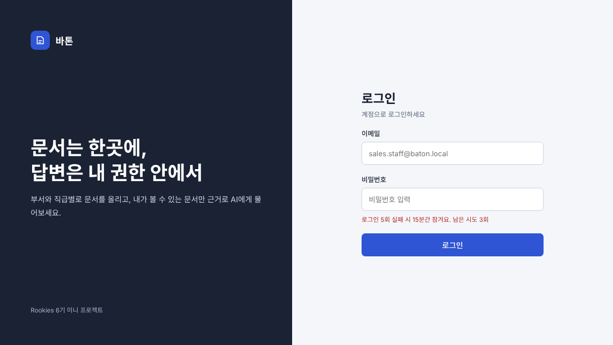
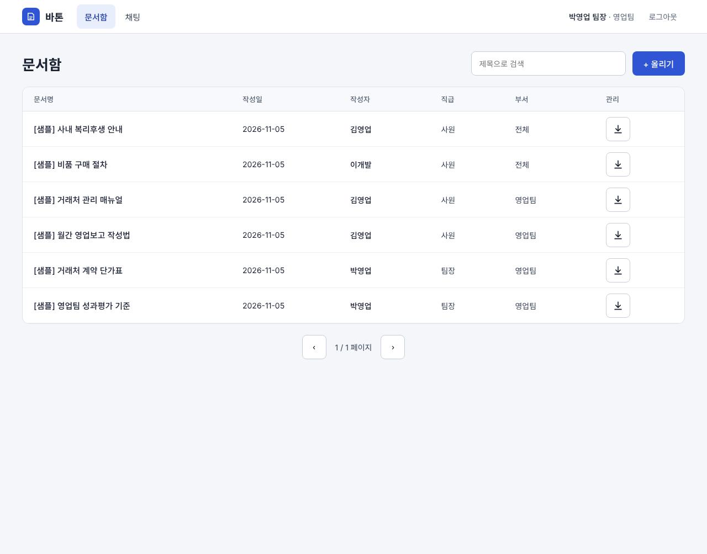
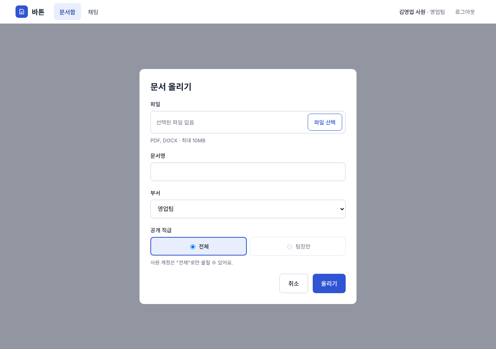
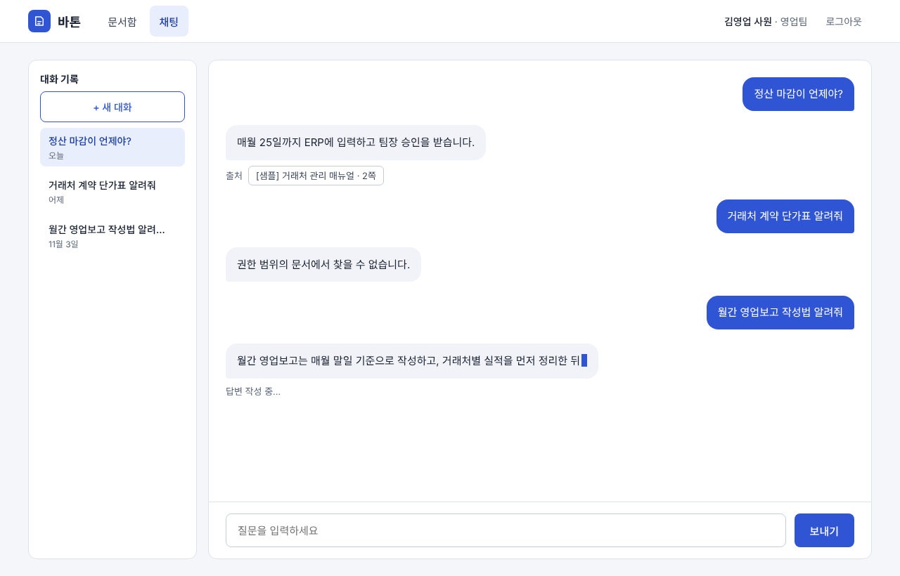

# 프론트엔드 개발 명세서

> 문서 상태: 초안 v0.3 (2026-11-06) · 산출물 6/9

## 1. 개요

- 바톤(Baton)의 프론트엔드(React) 범위인 화면, 컴포넌트, 상태 관리, API 연동, 보안을 정리한다.
- 담당: 이원구 (C) — 소유 디렉터리 `frontend/`
- 화면은 로그인, 문서함, 문서 올리기(모달), AI 업무 채팅 4개. 회원가입은 없다 (계정은 Flyway 시드).

### 1.1 기술 스택

| 구분 | 기술 |
|------|------|
| 프레임워크 | React 19.x, Vite, Node 20 LTS (세부 버전은 `package.json` 기준) |
| 라우팅 | React Router |
| 상태 관리 | Zustand |
| 스타일 | Tailwind CSS |
| 통신 | `fetch` (일반 API), `fetch` + `ReadableStream` (SSE 채팅) |
| 서빙 | Nginx (정적 파일 + `/api/*` 리버스 프록시) |

### 1.2 원칙

- 프론트엔드는 AI Module을 직접 호출하지 않는다. 모든 요청은 Backend(`/api`)를 거친다.
- 권한 판단은 서버가 한다. 화면의 숨김·비활성은 편의일 뿐 보안 통제가 아니다.
- 채팅 요청에 부서·직급 같은 권한 값을 보내지 않는다. 질문 문장만 보낸다.
- AI 답변은 텍스트로만 렌더링한다 (`dangerouslySetInnerHTML` 금지).
- 모든 서버 호출에는 로딩 표시(`LoadingSpinner`)와 오류 안내를 둔다. 문서 업로드와 AI 답변은 시간이 걸리므로 진행 중임을 반드시 보여 준다.
- 화면은 데스크톱 기준으로 만들고, 표와 입력창은 창 너비가 줄어도 깨지지 않게 반응형으로 구성한다.

## 2. 화면 구성

| 화면 | 경로 | 접근 | 연결 API |
|------|------|------|----------|
| 로그인 | `/login` | 비로그인 | `POST /auth/login` |
| 문서함 | `/documents` | 로그인 | `GET /documents` |
| 문서 올리기 (모달) | 별도 경로 없음 (문서함 위에 표시) | 로그인 | `POST /documents` |
| AI 업무 채팅 | `/chat` | 로그인 | `/chat/sessions` 계열 |

- `ProtectedRoute`: 비로그인이면 `/login`으로 보낸다. 로그인 후 기본 화면은 `/documents`.
- 새로고침 시 Access Token과 `member`는 메모리에서 사라진다. 앱 시작 시 `POST /auth/refresh`로 토큰을 다시 받고, 이어서 `GET /auth/me`로 `member`를 채운다. 어느 단계든 실패하면 `/login`으로 보낸다.
- 아래 화면 이미지는 영업 사원 계정 기준이다. 영업 팀장·개발팀 계정은 문서 목록과 채팅 결과만 다르고 레이아웃은 같다.

### 2.0 공통 헤더 (로그인 화면 제외)

- 구성: 바톤 로고, 메뉴(문서함, 채팅), 사용자 정보(예: "김영업 사원 · 영업팀"), 로그아웃 버튼
- 로그아웃: `POST /auth/logout` 호출 후 `authStore`를 비우고 `/login`으로 이동
- 사용자 정보는 `authStore`의 `member`에서 읽고, 부서 코드는 6장 표시 규칙으로 변환한다.

### 2.1 로그인



- 구성: 이메일, 비밀번호(마스킹), 로그인 버튼, 로그인 실패 시 남은 시도 횟수 안내
- 시안에는 안내 문구("5회 실패 시 15분간 잠겨요. 남은 시도 3회")가 처음부터 보이지만, 실제 구현은 실패 응답의 `remainingAttempts`를 받은 뒤에만 횟수를 표시한다.
- 호출: `POST /auth/login` — 요청 `{ email, password }`
- 성공: `accessToken`, `expiresIn`(1800초), `member { name, department, rank }`를 `authStore`에 저장하고 `/documents`로 이동. Refresh Token은 서버가 HttpOnly 쿠키로 내려주므로 프론트는 다루지 않는다.
- 실패:
  - 401 `AUTH_INVALID_CREDENTIALS` → 오류 안내 + `remainingAttempts`로 남은 시도 횟수 표시 (5회 실패 시 15분 잠금)
  - 423 `AUTH_LOCKED` → `lockedUntil` 시각까지 잠겨 있음을 안내
- 비밀번호는 `type=password`, 로그·콘솔 출력 금지

### 2.2 문서함



- 구성: 상단 메뉴(문서함, 채팅), 사용자 정보, 문서 검색, 올리기 버튼, 문서 표, 페이지 이동
- 표 열: 문서명, 작성일, 작성자, 직급, 부서, 관리(다운로드 버튼). 작성자와 직급은 별도 열로 표시한다.
- 삭제 기능은 화면에서 제외한다. 삭제 버튼과 확인창을 만들지 않고, `DELETE /documents/{id}`는 프론트에서 호출하지 않는다.
- 다운로드: 목록에 표시된 문서(= 서버가 권한 필터로 내려준 문서)에만 버튼이 있다. 권한 밖 문서는 목록에 없으므로 다운로드할 수 없다. 다운로드가 끝나면 "다운로드 되었습니다" 안내(토스트)를 잠시 보여 준다.
- 설계서 API에는 다운로드 엔드포인트가 없고 원본 파일도 저장하지 않으므로, 다운로드 API와 제공 방식(원본/마스킹 텍스트)은 팀 확인 후 API 설계서 PR로 먼저 합의한다. 합의 전에는 mock으로 버튼과 안내만 구현한다.
- 호출: `GET /documents?keyword=&page=0&size=10&sort=createdAt,desc`
- 응답 사용: `content[]`의 `title`, `author.name`·`author.rank`, `createdAt`, `department`, `minRank`, `status` / 페이징은 `page`, `totalPages`, `totalElements`
- 동작:
  - 검색어 입력 시 `page=0`으로 재조회, 페이지 이동은 `page`만 변경
  - 정렬 허용 필드는 `createdAt`, `title`뿐 (그 외 400)
- 권한 밖 문서는 서버가 목록과 건수에서 제외한다. 프론트는 걸러내지 않고 받은 그대로 보여준다.
- 다운로드 오류(API 합의 후): 404 `DOC_NOT_FOUND` 메시지 표시 후 목록 재조회

### 2.3 문서 올리기 (모달)



- 구성: 파일 선택(PDF·DOCX, 최대 10MB, 끌어다 놓기는 지원하지 않음), 문서명(최대 200자), 부서 선택, 공개 직급 선택, 취소·올리기 버튼
- 입력 규칙:
  - 부서는 내 부서(예: 영업팀)와 "전체"만 선택 가능 (`department`: 내 부서 코드 또는 `ALL`)
  - 공개 직급은 "전체"(`STAFF`)와 "팀장만"(`LEADER`) 중 선택한다. 사원 계정은 "전체"만 선택할 수 있다.
  - 문서명을 비워 두면 서버가 파일명을 사용한다 (화면에는 안내 문구를 두지 않는다).
- 호출: `POST /documents` (`multipart/form-data`: `file`, `department`, `minRank`, `title`)
- 성공: 201 응답 후 모달을 닫고 문서함 목록 재조회
- 실패:
  - 400 `FILE_INVALID_TYPE` → 형식 안내
  - 413 `FILE_TOO_LARGE` → 용량 안내
  - 403 `DOC_FORBIDDEN_SCOPE` → 권한 범위 초과 안내
  - 502 `AI_INGEST_FAILED` → 재시도 안내
- 형식·용량 검사는 즉시 피드백용이고 최종 검증은 서버가 한다. 마스킹·임베딩이 끝난 뒤 응답이 오므로 로딩 표시가 필요하다.

### 2.4 AI 업무 채팅



- 구성: 왼쪽 대화 기록(+ 새 대화), 질문·답변 말풍선, 출처 칩(문서명·쪽수), "답변 작성 중…" 표시, 입력창과 보내기 버튼
- 대화 기록은 날짜별(오늘, 어제, 이전 날짜)로 묶어 보여 준다. 세션 목록 응답의 날짜 필드는 API 설계서에서 확인한다.
- 대화 삭제 버튼과 스트리밍 중단 버튼은 제공하지 않는다. `DELETE /chat/sessions/{id}`는 프론트에서 호출하지 않는다.
- 호출:
  - `GET /chat/sessions` (목록), `POST /chat/sessions` (새 대화)
  - `GET /chat/sessions/{id}/messages` (이력)
  - `POST /chat/sessions/{id}/messages` (질문, SSE)
- 요청: `{ "question": "..." }` 하나뿐. 질문은 1~1,000자. 부서·직급 값은 보내지 않는다.
- 권한 밖 질문: 근거 문서가 없으면 서버가 "권한 범위의 문서에서 찾을 수 없습니다."를 `token` 1건으로 보낸다 (`sources`는 빈 배열). 일반 답변처럼 표시한다.
- 오류: `event: error`(`AI_UNAVAILABLE` 등) → "잠시 후 다시 시도해 주세요." + 재시도 버튼. 타인·없는 세션은 404 `SESSION_NOT_FOUND`.

## 3. 컴포넌트 구조

```text
frontend/src/
  pages/       LoginPage, DocumentsPage, ChatPage
  components/  DocumentTable, UploadModal, ChatSidebar, ChatMessage, SourceChip, LoadingSpinner
  stores/      authStore, chatStore
  services/    apiClient, documentApi, chatApi
  routes/      ProtectedRoute
  hooks/       (선택) 화면 로직을 분리할 커스텀 Hook. 예: SSE 수신 `useChatStream`, 문서 목록 조회 `useDocuments`
```

| 컴포넌트 | 역할 | 사용 화면 |
|----------|------|-----------|
| DocumentTable | 문서 표, 다운로드 버튼과 완료 안내 | 문서함 |
| UploadModal | 파일·부서·공개 직급 선택, 업로드 진행 표시 | 문서함 |
| ChatSidebar | 대화 기록, 새 대화, 대화 선택 | 채팅 |
| ChatMessage | 질문·답변 말풍선, 출처 칩 | 채팅 |
| SourceChip | 출처 문서명·쪽수 | 채팅 |
| LoadingSpinner | 로딩 표시 | 공통 |
| ProtectedRoute | 비로그인 접근 차단 | 공통 |

## 4. 상태 관리 (Zustand)

| 스토어 | 상태 | 액션 | 비고 |
|--------|------|------|------|
| authStore | `accessToken`, `member { name, department, rank }` | `login`, `logout`, `refresh` | 메모리에만 보관. `localStorage`·`sessionStorage` 저장 금지 |
| chatStore | `sessions`, `currentSessionId`, `messages`, `streaming`, `error` | `loadSessions`, `newSession`, `selectSession`, `sendQuestion` | 스트리밍 토큰을 `messages` 마지막 항목에 이어 붙임 |

- 로컬 상태: 검색어, 현재 페이지, 입력창 내용, 모달 열림 여부, 선택한 파일

## 5. API 연동

### 5.1 공통

- Base URL은 `/api` (Nginx 프록시). 개발 중에는 Vite 프록시로 `http://localhost:8080/api`에 연결한다.
- 인증 헤더: `Authorization: Bearer <accessToken>`
- 성공 응답은 `{ success, data, message }`, 실패 응답은 `{ success: false, error: { code, message } }`.
- `apiClient`는 401(`AUTH_TOKEN_INVALID` 등)을 받으면 `POST /auth/refresh`를 한 번 시도하고, 성공하면 원래 요청을 재시도한다. 실패하면 `authStore`를 비우고 `/login`으로 보낸다.
- 재시도 제외: `POST /auth/login`과 `POST /auth/refresh` 자체의 401은 재시도하지 않는다. 로그인 실패(`AUTH_INVALID_CREDENTIALS`)는 오류 안내로 처리하고, refresh 실패는 곧바로 `/login`으로 보낸다. (무한 반복 방지)

### 5.2 화면별 호출

| 화면 | 메서드·경로 | 요청 | 응답에서 쓰는 값 |
|------|-------------|------|------------------|
| 로그인 | `POST /auth/login` | `{ email, password }` | `accessToken`, `expiresIn`, `member` / 실패 시 `remainingAttempts`, `lockedUntil` |
| 공통 | `POST /auth/refresh` | 본문 없음 (쿠키) | 새 `accessToken` |
| 공통 | `POST /auth/logout` | — | 204 |
| 공통 | `GET /auth/me` | — | `name`, `department`, `rank` |
| 문서함 | `GET /documents` | `keyword`, `page`, `size`, `sort` | `content[]`, `page`, `totalPages`, `totalElements` |
| 올리기 | `POST /documents` | multipart: `file`, `department`, `minRank`, `title` | `id`, `status`, `chunkCount`, `maskedCount` |
| 채팅 | `GET/POST /chat/sessions` | — | 대화 목록 / 새 대화 |
| 채팅 | `GET /chat/sessions/{id}/messages` | — | `[{ id, role, content, sources, createdAt }]` (`sources`는 `ASSISTANT` 메시지에만 있음) |
| 채팅 | `POST /chat/sessions/{id}/messages` | `{ question }` | SSE 스트림 |

### 5.3 오류 코드별 처리

| HTTP | 코드 | 화면 처리 |
|------|------|-----------|
| 400 | `VALIDATION_FAILED`, `FILE_INVALID_TYPE` | 입력 안내 메시지 |
| 401 | `AUTH_INVALID_CREDENTIALS` | 로그인 실패 + 남은 시도 횟수 |
| 401 | `AUTH_TOKEN_INVALID`, `AUTH_REFRESH_INVALID` | 재발급 시도 후 실패하면 로그인 화면으로 |
| 403 | `DOC_FORBIDDEN_SCOPE` | 권한 안내 메시지 |
| 404 | `DOC_NOT_FOUND`, `SESSION_NOT_FOUND` | "찾을 수 없습니다" (권한 밖과 구분하지 않음) |
| 413 | `FILE_TOO_LARGE` | 용량 안내 |
| 423 | `AUTH_LOCKED` | 잠금 해제 시각 안내 |
| 500 | `INTERNAL_ERROR` | "잠시 후 다시 시도해 주세요" (상세 내용 미표시) |
| 502/503 | `AI_INGEST_FAILED`, `AI_UNAVAILABLE` | 재시도 안내 |

### 5.4 SSE 채팅 수신

SSE 요청은 POST와 `Authorization` 헤더가 필요하므로 `EventSource` 대신 `fetch` + `ReadableStream`으로 받는다.

| 이벤트 | 데이터 | 프론트 처리 |
|--------|--------|-------------|
| `token` | `{ "text": "..." }` | 마지막 답변 말풍선에 이어 붙이고 "답변 작성 중…" 표시 |
| `sources` | `[{ "docId", "title", "page" }]` | 출처 칩으로 표시 (문서명·쪽수) |
| `done` | `{ "messageId": 42 }` | 스트리밍 종료, 입력창 활성화 |
| `error` | `{ "code", "message" }` | 오류 문구와 재시도 버튼 표시 |

- 화면에 중단 버튼은 없다. 답변 수신 중 다른 화면으로 이동하면 `AbortController`로 요청을 정리한다.
- 받은 문자열은 텍스트 노드로만 그린다.
- 이벤트 형식은 API 설계서 5.1 기준이다.

## 6. 코드값 표시 규칙

| 코드 | 화면 표시 |
|------|-----------|
| `SALES` | 영업팀 |
| `DEV` | 개발팀 |
| `ALL` | 전체 |
| `STAFF` (직급) | 사원 |
| `LEADER` (직급) | 팀장 |
| `STAFF` (공개 직급) | 전체 |
| `LEADER` (공개 직급) | 팀장만 |

- 열람 규칙(서버 기준): `(문서 부서 = 전체 또는 내 부서)` AND `(공개 직급 = 전체 또는 내가 팀장)`
- 계정별 열람 가능 문서 수: 영업 사원 4, 영업 팀장 6, 개발 사원 4, 개발 팀장 6

## 7. 프론트엔드 보안

| 항목 | 점검 내용 | 구현 방법 |
|------|-----------|-----------|
| 토큰 저장 | Access Token을 브라우저 저장소에 두지 않는다 | `authStore` 메모리 보관, Refresh Token은 HttpOnly 쿠키 |
| XSS | AI 답변·문서명 등 서버 문자열을 HTML로 해석하지 않는다 | 텍스트로만 렌더링, `dangerouslySetInnerHTML` 금지 |
| CSP | 허용 출처를 제한한다 | Nginx 헤더 설정 (CSP 담당 A, 배포 담당 F와 협의) |
| 라우트 가드 | 화면 접근 차단은 편의일 뿐 최종 판단은 서버 | `ProtectedRoute` + 서버 401/403/404 처리 |
| 입력 검증 | 형식·용량·길이 검사는 안내용 | 업로드 10MB·PDF/DOCX, 질문 1,000자, 문서명 200자 |
| 권한 값 | 클라이언트가 권한 값을 보내지 않는다 | 채팅 요청은 `question`만 전송 |
| 비밀정보 | 키·비밀번호를 소스와 Git에 넣지 않는다 | `.env.example`만 커밋 |
| 의존성 | 취약한 패키지 점검 | `npm audit` 결과를 보안점검서에 기록 |

## 8. 변경 이력

| 버전 | 날짜 | 변경 내용 |
|------|------|-----------|
| v0.1 | 2026-11-05 | 초안 작성 (화면 구성, 컴포넌트, 상태 관리, API 연동, 코드값, 보안) |
| v0.2 | 2026-11-06 | 가이드 요구사항(로딩 피드백·반응형·커스텀 Hook)과 UI 시안 대조 반영, React 메이저 버전을 19.x로 변경(세부 버전은 기능에 맞게 `package.json` 기준): 공통 헤더·끌어다 놓기·날짜별 대화 기록 추가, 새로고침 시 `GET /auth/me` 복구 순서, 401 재시도 제외 경로, 대화 삭제 API 표 보강, `sources` 규칙, CSP 담당 정정 |
| v0.3 | 2026-11-06 | 시안 수정 반영: 업로드 모달에서 끌어다 놓기·마스킹 안내·"(선택)" 문구 제거, 부서 "(내 부서)" 표기 삭제, 공개 직급 "사원 이상"을 "전체"로 변경, 문서함 열 순서를 작성일·작성자·직급·부서·관리로 변경, 문서 삭제·대화 삭제·스트리밍 중단 버튼 제외, 다운로드 완료 안내 추가 |
