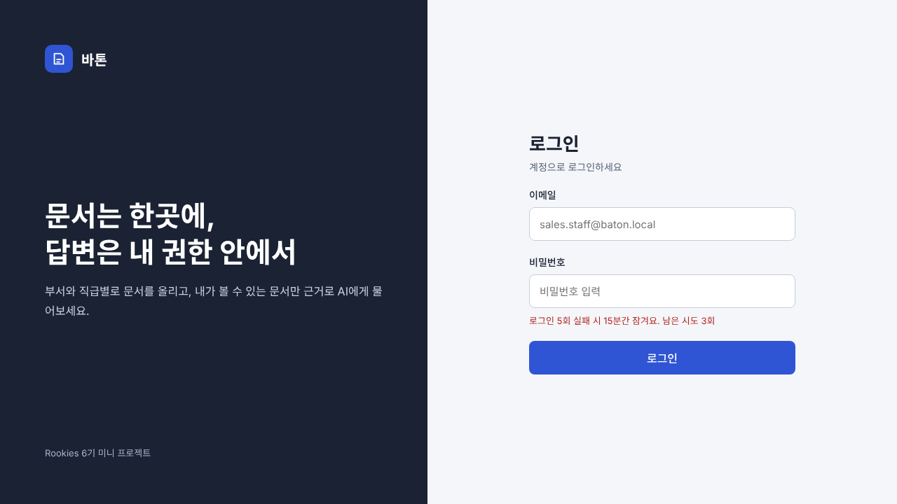
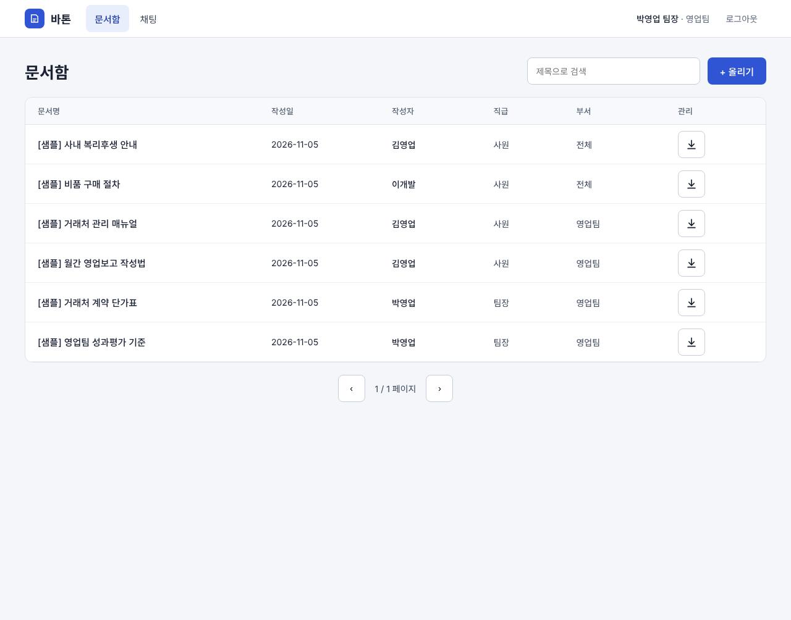
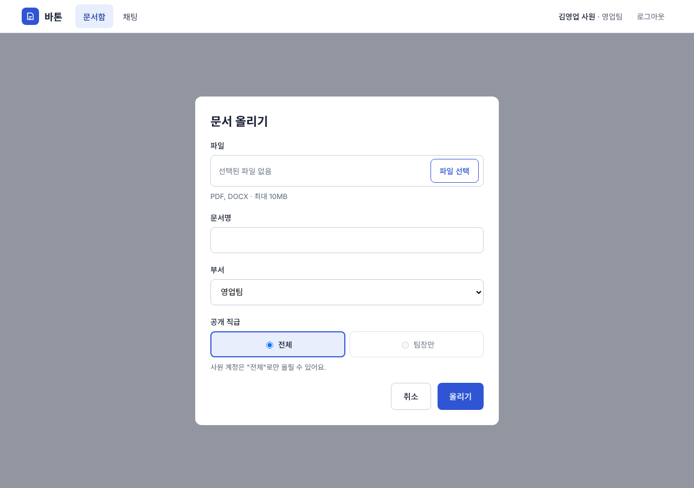
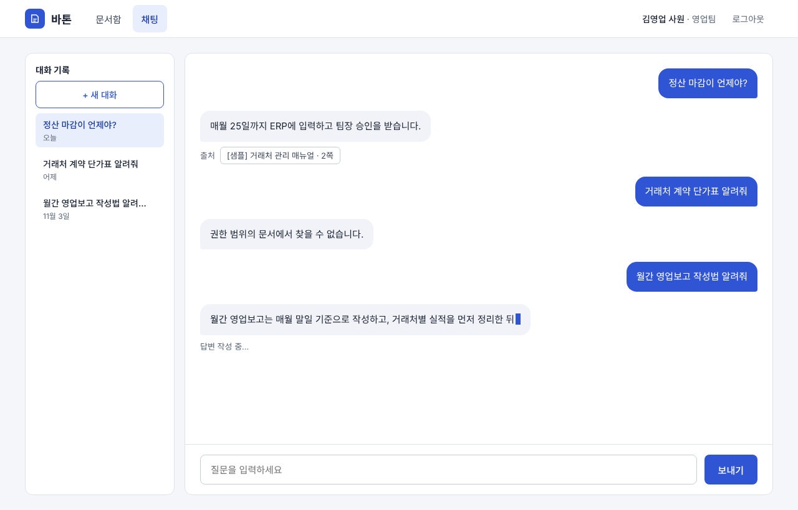

# Frontend 개발 명세서

> 문서 상태: v0.8 (2026-11-12) · 산출물 6/9 · 작성: C 이원구

## 1. 개요

- 바톤(Baton)의 Frontend(React) 범위인 화면, 컴포넌트, 상태 관리, API 연동, 보안을 정리한다.
- 담당: 이원구 (C) — 소유 디렉터리 `frontend/`
- 화면은 로그인, 문서함, 문서 올리기(모달), AI 업무 채팅 4개. 회원가입은 없다 (계정은 Flyway 시드).

### 1.1 기술 스택

| 구분 | 기술 |
|------|------|
| 프레임워크 | React 19.3.x, Vite 8.x, Node 22 (빌드 이미지 기준) |
| 라우팅 | React Router 7.x |
| 상태 관리 | Zustand 5.x |
| 스타일 | Tailwind CSS 4.x (색·글꼴은 `src/index.css`의 `@theme` 토큰, 3.1절) |
| 통신 | `fetch` (일반 API), `fetch` + `ReadableStream` (SSE 채팅) |
| 답변 표시 | react-markdown 10.x (마크다운 렌더링, 원시 HTML은 해석하지 않음) |
| 서빙 | Nginx (정적 파일 + `/api/*` 리버스 프록시) |

### 1.2 원칙

- Frontend는 AI Module을 직접 호출하지 않는다. 모든 요청은 Backend(`/api`)를 거친다.
- 권한 판단은 서버가 한다. 화면의 숨김·비활성은 편의일 뿐 보안 통제가 아니다.
- 채팅 요청에 부서·직급 같은 권한 값을 보내지 않는다. 질문 문장만 보낸다.
- AI 답변은 마크다운(`react-markdown`)으로 렌더링한다. 원시 HTML은 해석하지 않으며(HTML 허용 플러그인 미사용), `dangerouslySetInnerHTML`은 사용하지 않는다. 사용자가 입력한 질문과 문서명 같은 그 밖의 서버 문자열은 텍스트로만 표시한다.
- 모든 서버 호출에는 로딩 표시(`LoadingSpinner`)와 오류 안내를 둔다. 문서 업로드와 AI 답변은 시간이 걸리므로 진행 중임을 반드시 보여 준다.
- 화면은 데스크톱 기준으로 만들고, 표와 입력창은 창 너비가 줄어도 깨지지 않게 반응형으로 구성한다.

## 2. 화면 구성

| 화면 | 경로 | 접근 | 연결 API |
|------|------|------|----------|
| 로그인 | `/login` | 비로그인 | `POST /auth/login` |
| 문서함 | `/documents` | 로그인 | `GET /documents`, `GET /documents/{id}/download` |
| 문서 올리기 (모달) | 별도 경로 없음 (문서함 위에 표시) | 로그인 | `POST /documents` |
| AI 업무 채팅 | `/chat` | 로그인 | `/chat/sessions` 계열 |

- `ProtectedRoute`: 비로그인이면 `/login`으로 보낸다. 로그인 후 기본 화면은 `/documents`.
- 새로고침 시 Access Token과 `member`는 메모리에서 사라진다. 앱 시작 시 `POST /auth/refresh`로 토큰을 다시 받고, 이어서 `GET /auth/me`로 `member`를 채운다. 어느 단계든 실패하면 `/login`으로 보낸다.
- 아래 화면 이미지는 영업 사원 계정 기준이다. 영업 팀장·개발팀 계정은 문서 목록과 채팅 결과만 다르고 레이아웃은 같다.

### 2.0 공통 헤더 (로그인 화면 제외)

- 구성: 바톤 로고, 메뉴(문서함, 채팅), 사용자 정보(예: "김영업 사원 · 영업팀"), 로그아웃 버튼
- 로그아웃: `POST /auth/logout` 호출 후 `authStore`를 비우고 `/login`으로 이동
- 사용자 정보는 `authStore`의 `member`에서 읽고, 부서 코드는 6장 표시 규칙으로 변환한다.

### 2.1 로그인



- 구성: 이메일, 비밀번호(마스킹), 로그인 버튼, 로그인 실패 시 남은 시도 횟수 안내
- 시안에는 안내 문구("5회 실패 시 15분간 잠겨요. 남은 시도 3회")가 처음부터 보이지만, 실제 구현은 실패 응답의 `error.remainingAttempts`를 받은 뒤에만 횟수를 표시한다.
- 호출: `POST /auth/login` — 요청 `{ email, password }`
- 성공: `accessToken`, `expiresIn`(1800초), `member { name, department, rank }`를 `authStore`에 저장하고 `/documents`로 이동. Refresh Token은 서버가 HttpOnly 쿠키로 내려주므로 Frontend는 다루지 않는다.
- 실패:
  - 401 `AUTH_INVALID_CREDENTIALS` → 오류 안내 + `error.remainingAttempts`로 남은 시도 횟수 표시 (5회 실패 시 15분 잠금). 존재하지 않는 계정도 같은 401로 응답하므로(계정 존재 여부 노출 방지) 화면 문구도 구분하지 않는다.
  - 423 `AUTH_LOCKED` → `error.lockedUntil`(ISO 8601) 시각까지 잠겨 있음을 안내. 남은 시간은 분 단위로 올림해 표시한다(최소 1분).
- 비밀번호는 `type=password`, 로그·콘솔 출력 금지

### 2.2 문서함



- 구성: 상단 메뉴(문서함, 채팅), 사용자 정보, 문서 검색, 올리기 버튼, 문서 표, 페이지 이동
- 표 열: 문서명, 작성일, 작성자, 직급, 부서, 관리(다운로드 버튼). 작성자와 직급은 별도 열로 표시한다.
- 삭제 기능은 없다. 삭제 버튼과 확인창을 만들지 않는다.
- 다운로드: 목록에 표시된 문서(= 서버가 권한 필터로 내려준 문서)에만 버튼이 있다. 권한 밖 문서는 목록에 없으므로 다운로드할 수 없다. 다운로드 API가 200을 응답하면 응답의 `message`("다운로드되었습니다.")를 토스트로 잠시 보여 준다. 실제 파일은 받지 않는다.
- 다운로드 호출: `GET /documents/{id}/download` (API 설계서 4.4절). 원본 파일을 보관하지 않으므로 서버는 권한 확인 결과만 응답한다.
- 호출: `GET /documents?keyword=&page=0&size=10&sort=createdAt,desc`
- 응답 사용: `content[]`의 `title`, `author.name`·`author.rank`, `createdAt`, `department`, `minRank`, `status` / 페이징은 `page`, `totalPages`, `totalElements`
- 동작:
  - 검색어 입력 시 `page=0`으로 재조회, 페이지 이동은 `page`만 변경
  - 정렬 허용 필드는 `createdAt`, `title`뿐 (그 외 400)
- 권한 밖 문서는 서버가 목록과 건수에서 제외한다. Frontend는 걸러내지 않고 받은 그대로 보여준다.
- 다운로드 오류: 404 `DOC_NOT_FOUND` 메시지 표시 후 목록 재조회

### 2.3 문서 올리기 (모달)



- 구성: 파일 선택(PDF·DOCX, 최대 10MB, 끌어다 놓기는 지원하지 않음), 문서명(최대 200자), 부서 선택, 공개 직급 선택, 취소·올리기 버튼
- 입력 규칙:
  - 부서는 내 부서(예: 영업팀)와 "전체"만 선택 가능 (`department`: 내 부서 코드 또는 `ALL`)
  - 공개 직급은 "전체"(`STAFF`)와 "팀장만"(`LEADER`) 중 선택한다. 사원 계정은 "전체"만 선택할 수 있다.
  - 문서명을 비워 두면 서버가 파일명을 사용한다 (화면에는 안내 문구를 두지 않는다).
- 호출: `POST /documents` (`multipart/form-data`: `file`, `department`, `minRank`, `title`)
- 성공: 201 응답 후 모달을 닫고 문서함 목록 재조회
- 실패:
  - 400 `FILE_INVALID_TYPE` → 형식 안내
  - 413 `FILE_TOO_LARGE` → 용량 안내
  - 403 `DOC_FORBIDDEN_SCOPE` → 권한 범위 초과 안내
  - 502 `AI_INGEST_FAILED` → 재시도 안내
- 형식·용량 검사는 즉시 피드백용이고 최종 검증은 서버가 한다. 마스킹·임베딩이 끝난 뒤 응답이 오므로 로딩 표시가 필요하다.

### 2.4 AI 업무 채팅



- 구성: 왼쪽 대화 기록(+ 새 대화), 질문·답변 말풍선, 답변 아래 "참고 문서" 칩(문서명·쪽수) 1개, "답변 작성 중…" 표시, 입력창과 보내기 버튼
- 대화 기록은 세션의 `updatedAt`을 달력 기준으로 나눠 오늘, 어제, 지난 7일, 이전 4개 그룹으로 보여 준다. 항목이 없는 그룹은 표시하지 않고, 날짜를 해석할 수 없는 항목은 "이전"에 넣는다.
- 답변 본문은 마크다운(굵은 글씨, 번호·글머리 목록 등)으로 표시하고, 사용자의 질문은 그대로 텍스트로 표시한다.
- 참고 문서 칩은 답변마다 `sources`의 첫 번째 항목 1개만 표시한다(검색 점수 1등 문서, 문서당 1개 — `7.AI모듈연동명세서.md`의 출처 규칙). PDF는 "문서명 · N쪽", DOCX는 `page`가 `null`이라 문서명만 표시한다.
- 새 질문이 추가되거나 스트리밍으로 글자가 늘어나면 대화 영역이 자동으로 맨 아래로 이동한다.
- 질문 입력창은 1,000자로 제한(`maxLength`)한다. 답변을 받는 동안(스트리밍·불러오는 중)에는 입력창과 보내기 버튼을 비활성화해 중복 전송을 막는다.
- 대화 삭제와 스트리밍 중단 기능은 두지 않는다.
- 호출:
  - `GET /chat/sessions` (목록), `POST /chat/sessions` (새 대화)
  - `GET /chat/sessions/{id}/messages` (이력)
  - `POST /chat/sessions/{id}/messages` (질문, SSE)
- 요청: `{ "question": "..." }` 하나뿐. 질문은 1~1,000자. 부서·직급 값은 보내지 않는다.
- 권한 밖 질문: 근거 문서가 없으면 서버가 "권한 범위의 문서에서 찾을 수 없습니다."를 `token` 1건으로 보낸다 (`sources`는 빈 배열). 일반 답변처럼 표시한다. 같은 문구가 관련도 기준에 못 미칠 때도 내려오며, 화면에서는 두 경우를 구분하지 않는다. 두 경우 모두 `sources`가 비어 있어 참고 문서 칩은 표시되지 않는다(LLM이 고정 문구로 거절하는 경우도 AI 모듈이 `sources`를 비운다).
- 오류: `event: error`(`AI_UNAVAILABLE` 등) → "잠시 후 다시 시도해 주세요." + 재시도 버튼. 타인·없는 세션은 404 `SESSION_NOT_FOUND`. 클라이언트가 만드는 `NETWORK_ERROR`(네트워크 확인 안내)와 `STREAM_INTERRUPTED`("답변이 중간에 끊겼습니다") 오류도 같은 방식으로 안내하고, 정해지지 않은 코드는 "잠시 후 다시 시도해 주세요."로 처리한다.

## 3. 컴포넌트 구조

```text
frontend/src/
  pages/       LoginPage, DocumentsPage, ChatPage
  components/  DocumentTable, UploadModal, ChatSidebar, ChatMessage, SourceChip, LoadingSpinner, Header, Layout, ProtectedRoute, Toast
  stores/      authStore, toastStore
  services/    apiClient, authApi, documentApi, chatApi
  utils/       groupByDate.js (대화 목록 날짜 그룹화)
  constants/   index.js (RANK, DEPT 코드값과 표시 이름)
  mocks/       data.js (시드 계정·문서), canRead.js (열람 판정), chat.js (채팅 mock)
```

| 컴포넌트 | 역할 | 사용 화면 |
|----------|------|-----------|
| DocumentTable | 문서 표, 다운로드 버튼과 완료 안내 | 문서함 |
| UploadModal | 파일·부서·공개 직급 선택, 업로드 진행 표시 | 문서함 |
| ChatSidebar | 대화 기록(날짜별 그룹), 새 대화, 대화 선택 | 채팅 |
| ChatMessage | 질문·답변 말풍선(답변은 마크다운), 참고 문서 칩 1개 | 채팅 |
| SourceChip | 참고 문서 칩(문서명·쪽수, DOCX는 쪽수 없음) | 채팅 |
| LoadingSpinner | 로딩 표시 | 공통 |
| ProtectedRoute | 비로그인 접근 차단 | 공통 |
| Header | 로고, 메뉴, 사용자 정보, 로그아웃 (2.0 공통 헤더) | 로그인 제외 전체 |
| Layout | 헤더와 본문 영역의 공통 틀 | 로그인 제외 전체 |
| Toast | 다운로드 완료 등 짧은 안내 (`toastStore`가 상태 보관) | 공통 |

### 3.1 스타일 기준

- 팀 디자인 시안의 색과 글꼴은 `src/index.css`의 Tailwind `@theme` 토큰으로 관리하고, 화면은 토큰 이름(`bg-brand`, `text-sub`, `border-line`, `bg-bubble`, `text-danger` 등)으로 쓴다.
- 글꼴은 Noto Sans KR, 화면은 밝은 테마 하나만 쓴다. 기본 템플릿의 전역 스타일(제목 크기·가운데 정렬·다크 모드 자동 전환)은 시안과 충돌해 제거했다.

| 토큰 | 값 | 용도 |
|------|----|------|
| `bg` | `#F4F6FA` | 화면 배경 |
| `ink` | `#1A2233` | 본문 글자 |
| `sub` | `#5A6578` | 보조 글자 |
| `line` | `#DDE2EB` | 구분선·테두리 |
| `field` | `#C5CCDA` | 입력창·칩 테두리 |
| `brand` / `brand-dark` / `brand-soft` | `#2F55D4` / `#1F3FA8` / `#E8EEFC` | 주 색상(버튼·강조) |
| `bubble` | `#F1F3F8` | 답변 말풍선 |
| `danger` | `#B3261E` | 오류 문구 |

## 4. 상태 관리 (Zustand)

| 스토어 | 상태 | 액션 | 비고 |
|--------|------|------|------|
| authStore | `accessToken`, `member { name, department, rank }`, `ready` | `setAuth`, `clear`, `setReady` | 메모리에만 보관. `localStorage`·`sessionStorage` 저장 금지. `ready`는 앱 시작 시 로그인 복구(refresh → me)가 끝났는지 나타낸다. 로그인·재발급 호출은 `authApi`/`apiClient`가 하고 결과를 스토어에 저장한다. |
| toastStore | `message` 또는 목록 | 표시, 닫기 | 다운로드 완료 안내 등에 사용 |

- 채팅 화면의 상태(대화 목록, 선택한 대화, 메시지, 스트리밍 여부)는 `ChatPage`의 로컬 상태로 관리하고, 전역 스토어는 `authStore`와 `toastStore`만 둔다.
- 로컬 상태: 검색어, 현재 페이지, 입력창 내용, 모달 열림 여부, 선택한 파일

## 5. API 연동

### 5.1 공통

- Base URL은 `/api` (Nginx 프록시). 개발 중에는 Vite 프록시로 `http://localhost:8080/api`에 연결한다.
- 인증 헤더: `Authorization: Bearer <accessToken>`
- Refresh Token 쿠키(`baton_rt`)는 `HttpOnly; Secure; SameSite=Strict; Path=/api/auth`로 내려온다(`5.Backend개발명세서.md`). `/api/auth` 호출에만 자동으로 실리며, Frontend는 쿠키를 읽거나 쓰지 않는다.
- 성공 응답은 `{ success, data, message }`, 실패 응답은 `{ success: false, error: { code, message } }`.
- `apiClient`는 401(`AUTH_TOKEN_INVALID` 등)을 받으면 `POST /auth/refresh`를 한 번 시도하고, 성공하면 원래 요청을 재시도한다. 실패하면 `authStore`를 비우고 `/login`으로 보낸다.
- 재시도 제외: `POST /auth/login`과 `POST /auth/refresh` 자체의 401은 재시도하지 않는다. 로그인 실패(`AUTH_INVALID_CREDENTIALS`)는 오류 안내로 처리하고, refresh 실패는 곧바로 `/login`으로 보낸다. (무한 반복 방지)

### 5.2 화면별 호출

| 화면 | 메서드·경로 | 요청 | 응답에서 쓰는 값 |
|------|-------------|------|------------------|
| 로그인 | `POST /auth/login` | `{ email, password }` | `accessToken`, `expiresIn`, `member` / 실패 시 `error.remainingAttempts`(401), `error.lockedUntil`(423, ISO 8601) |
| 공통 | `POST /auth/refresh` | 본문 없음 (쿠키) | 새 `accessToken` |
| 공통 | `POST /auth/logout` | — | 204 |
| 공통 | `GET /auth/me` | — | `name`, `department`, `rank` |
| 문서함 | `GET /documents` | `keyword`, `page`, `size`, `sort` | `content[]`, `page`, `totalPages`, `totalElements` |
| 문서함 | `GET /documents/{id}/download` | — | `message` (토스트) |
| 올리기 | `POST /documents` | multipart: `file`, `department`, `minRank`, `title` | `id`, `status`, `chunkCount`, `maskedCount` |
| 채팅 | `GET/POST /chat/sessions` | — | 대화 목록 / 새 대화 |
| 채팅 | `GET /chat/sessions/{id}/messages` | — | `[{ id, role, content, sources, createdAt }]` (`sources`는 `ASSISTANT` 메시지에만 있음) |
| 채팅 | `POST /chat/sessions/{id}/messages` | `{ question }` | SSE 스트림 |

### 5.3 오류 코드별 처리

| HTTP | 코드 | 화면 처리 |
|------|------|-----------|
| 400 | `VALIDATION_FAILED`, `FILE_INVALID_TYPE` | 입력 안내 메시지 |
| 401 | `AUTH_INVALID_CREDENTIALS` | 로그인 실패 + 남은 시도 횟수 |
| 401 | `AUTH_TOKEN_INVALID`, `AUTH_REFRESH_INVALID` | 재발급 시도 후 실패하면 로그인 화면으로 |
| 403 | `DOC_FORBIDDEN_SCOPE` | 권한 안내 메시지 |
| 404 | `DOC_NOT_FOUND`, `SESSION_NOT_FOUND` | "찾을 수 없습니다" (권한 밖과 구분하지 않음) |
| 404·405·415 | `NOT_FOUND`, `METHOD_NOT_ALLOWED`, `UNSUPPORTED_MEDIA_TYPE` | 정상 사용 중에는 발생하지 않는 공통 오류(API 설계서 7장). 채팅에서는 "잠시 후 다시 시도해 주세요."로 처리 |
| — | `NETWORK_ERROR`, `STREAM_INTERRUPTED` (클라이언트) | 채팅: 네트워크 확인 안내, 답변 중간에 끊김 안내 |
| 413 | `FILE_TOO_LARGE` | 용량 안내 |
| 423 | `AUTH_LOCKED` | 잠금 해제 시각 안내 |
| 500 | `INTERNAL_ERROR` | "잠시 후 다시 시도해 주세요" (상세 내용 미표시) |
| 502/503 | `AI_INGEST_FAILED`, `AI_UNAVAILABLE` | 재시도 안내 |

로그인 실패 응답은 다른 오류와 같은 형식이며 부가 정보는 `error` 안에 둔다.

- 401: `{ "success": false, "error": { "code": "AUTH_INVALID_CREDENTIALS", "message": "...", "remainingAttempts": 3 } }`
- 423: `{ "success": false, "error": { "code": "AUTH_LOCKED", "message": "...", "lockedUntil": "2026-11-10T14:20:00+09:00" } }`

### 5.4 SSE 채팅 수신

SSE 요청은 POST와 `Authorization` 헤더가 필요하므로 `EventSource` 대신 `fetch` + `ReadableStream`으로 받는다.

| 이벤트 | 데이터 | Frontend 처리 |
|--------|--------|-------------|
| `token` | `{ "text": "..." }` | 마지막 답변 말풍선에 이어 붙이고 "답변 작성 중…" 표시 |
| `sources` | `[{ "docId", "title", "page" }]` | 첫 번째 항목만 "참고 문서" 칩으로 표시 (문서명·쪽수, `page`가 `null`이면 쪽수 생략). 빈 배열이면 칩을 그리지 않음 |
| `done` | `{ "messageId": 42 }` | 스트리밍 종료, 입력창 활성화 |
| `error` | `{ "code", "message" }` | 오류 문구와 재시도 버튼 표시 |

- 문서명·출처 칩 등 서버 문자열은 텍스트 노드로만 그린다. `token`으로 받은 답변 본문만 마크다운으로 렌더링하며 원시 HTML은 해석하지 않는다.
- 오류도 HTTP 200 응답 안의 `error` 이벤트로 올 수 있으므로, 상태 코드만 보지 않고 이벤트 종류별로 처리한다.
- Backend가 `sources`의 `docId`를 DB 권한으로 다시 확인해 통과한 것만 중계하므로, Frontend는 받은 `sources`를 다시 걸러내지 않는다.
- 이벤트 형식은 API 설계서 5.1 기준이다.

### 5.5 프론트 컨테이너와 프록시

- 프론트 컨테이너는 nginx가 3000 포트로 정적 파일을 서빙하고, 새로고침 시 404가 나지 않도록 `try_files $uri /index.html`을 사용한다.
- 브라우저는 앞단 nginx(80)로 접속한다. `/api`는 백엔드로, 그 외 경로는 `frontend:3000`으로 전달한다.
- 백엔드 컨트롤러는 `/api` 접두사를 매핑에 포함한다(예: `/api/documents`). 프록시는 `/api`를 제거하지 않고 그대로 전달해야 한다.
- 채팅 SSE(`POST /api/chat/sessions/{id}/messages`)는 토큰이 실시간으로 전달돼야 하므로 프록시에서 `proxy_buffering off`를 설정하고 업스트림 HTTP 버전을 1.1(`proxy_http_version 1.1`)로 지정한다.

## 6. 코드값 표시 규칙

| 코드 | 화면 표시 |
|------|-----------|
| `SALES` | 영업팀 |
| `DEV` | 개발팀 |
| `ALL` | 전체 |
| `STAFF` (직급) | 사원 |
| `LEADER` (직급) | 팀장 |
| `STAFF` (공개 직급) | 전체 |
| `LEADER` (공개 직급) | 팀장만 |

- 열람 규칙(서버 기준): `(문서 부서 = 전체 또는 내 부서)` AND `(공개 직급 = 전체 또는 내가 팀장)`
- 계정별 열람 가능 문서 수: 영업 사원 4, 영업 팀장 6, 개발 사원 4, 개발 팀장 6

## 7. Frontend 보안

| 항목 | 점검 내용 | 구현 방법 |
|------|-----------|-----------|
| 토큰 저장 | Access Token을 브라우저 저장소에 두지 않는다 | `authStore` 메모리 보관, Refresh Token은 HttpOnly 쿠키 |
| XSS | 서버 문자열의 원시 HTML을 해석하지 않는다 | 답변은 react-markdown으로 렌더링(HTML 허용 플러그인 미사용), 문서명·출처는 텍스트로 렌더링, `dangerouslySetInnerHTML` 금지 |
| CSP | 허용 출처를 제한한다 | Nginx 헤더 설정 (CSP 담당 A, 배포 담당 F와 협의) |
| 라우트 가드 | 화면 접근 차단은 편의일 뿐 최종 판단은 서버 | `ProtectedRoute` + 서버 401/403/404 처리 |
| 입력 검증 | 형식·용량·길이 검사는 안내용 | 업로드 10MB·PDF/DOCX, 질문 1,000자, 문서명 200자 |
| 권한 값 | 클라이언트가 권한 값을 보내지 않는다 | 채팅 요청은 `question`만 전송 |
| 비밀정보 | 키·비밀번호를 소스와 Git에 넣지 않는다 | `.env.example`만 커밋 |
| 의존성 | 취약한 패키지 점검 | `npm audit` 결과를 보안점검서에 기록 (운영 의존성 0건, 개발 의존성 eslint 하위 moderate 4건은 잔여 위험으로 기록) |

- 점검 결과는 `9.보안점검서.md` 3장 Frontend 점검표(F-1~F-7)에 기록했다.

## 8. mock 시드 데이터

실제 서버 연동 전 화면 개발용 데이터다. 비밀번호는 문서와 Git에 적지 않고 팀 채널로만 공유한다.

- mock 모드는 `VITE_USE_MOCK=true`일 때만 동작한다. 서버가 준비되면 같은 서비스 함수에서 실제 호출로 바꾼다.

### 8.1 계정

| 이름 | 이메일 | 부서 | 직급 | 열람 가능 문서 수 |
|------|--------|------|------|------------------|
| 김영업 | sales.staff@baton.local | SALES | STAFF | 4 |
| 박영업 | sales.lead@baton.local | SALES | LEADER | 6 |
| 이개발 | dev.staff@baton.local | DEV | STAFF | 4 |
| 최개발 | dev.lead@baton.local | DEV | LEADER | 6 |

### 8.2 문서 (10건, 권한 그룹 5개 × 2건)

| 부서 | 공개 직급 | 문서 |
|------|-----------|------|
| ALL | STAFF | 사내 복리후생 안내, 비품 구매 절차 |
| SALES | STAFF | 거래처 관리 매뉴얼, 월간 영업보고 작성법 |
| SALES | LEADER | 거래처 계약 단가표, 영업팀 성과평가 기준 |
| DEV | STAFF | 개발 환경 세팅 가이드, 배포 절차서 |
| DEV | LEADER | 서버 접근권한 관리 정책, 외주 개발 계약 현황 |

### 8.3 필드명 기준

mock 데이터도 API 응답과 같은 필드명을 쓴다: `department`, `rank`, `minRank`, `createdAt`, `author { name, rank }`, `status`.

## 9. 협업 규칙

공통 규칙(브랜치 보호·리뷰·머지 방식·API 변경 절차)은 `1.프로젝트계획서.md` 7장을 따른다. Frontend에만 해당하는 규칙은 아래와 같다.

- 브랜치: `feature/fe-<기능>` (예: `feature/fe-upload-modal`)
- 커밋: `type(scope): 제목` (type은 feat/fix/docs/style/refactor/test/chore, scope는 `fe`, 한글 명사형 50자 이내, 마침표 없음)
- 작업 단위(파일 1개 또는 기능 1개)가 끝날 때마다 커밋하고 `git push`한다.
- `git add`는 파일을 지정해서 한다 (`git add .`, `git commit -a` 금지). `.env`는 커밋하지 않는다.

## 변경 이력

| 버전 | 날짜 | 작성자 | 변경 내용 |
|------|------|--------|-----------|
| v0.1 | 2026-11-05 | C 이원구 | 초안 작성 (화면 구성, 컴포넌트, 상태 관리, API 연동, 코드값, 보안) |
| v0.2 | 2026-11-06 | C 이원구 | 가이드 요구사항(로딩 피드백·반응형·커스텀 Hook)과 UI 시안 대조 반영, React 버전을 19.3.x로 변경(가이드 기준), 공통 헤더·끌어다 놓기·날짜별 대화 기록 추가, 새로고침 시 `GET /auth/me` 복구 순서, 401 재시도 제외 경로, 대화 삭제 API 표 보강, `sources` 규칙, CSP 담당 정정 |
| v0.3 | 2026-11-06 | C 이원구 | 시안 수정 반영: 업로드 모달에서 끌어다 놓기·마스킹 안내·"(선택)" 문구 제거, 부서 "(내 부서)" 표기 삭제, 공개 직급 "사원 이상"을 "전체"로 변경, 문서함 열 순서를 작성일·작성자·직급·부서·관리로 변경, 삭제 기능 제외, 다운로드 완료 안내 추가 |
| v0.4 | 2026-11-07 | C 이원구 | 구현 현황·mock 시드·협업 규칙 절 추가, 디렉터리 구조(constants·mocks·toastStore)와 authStore 상태·액션을 구현 기준으로 수정, mock 필드명을 API 기준으로 정렬 |
| v0.5 | 2026-11-07 | B 황지영 | 다운로드 API 확정 반영, 대화 삭제·스트리밍 중단 제거, 라이브러리 버전 추가, 구현 현황 절 삭제, 협업 규칙을 FE 전용으로 정리(머지 방식은 계획서 따름), 용어·양식 통일 |
| v0.6 | 2026-11-09 | C 이원구 | 로그인 실패 응답 형식 확정 반영(`error.remainingAttempts`·`error.lockedUntil`, ISO 8601, 계정 존재 여부 비노출), 프론트 컨테이너·프록시 절(5.5) 추가 |
| v0.7 | 2026-11-11 | C 이원구 | 구현 반영: 답변 마크다운 렌더링(react-markdown)과 XSS 문구 정정, 대화 기록 날짜 그룹(오늘·어제·지난 7일·이전), 디렉터리 구조·상태 관리를 구현 기준으로 정정(`chatStore`·`hooks`·`routes/` 제거, `utils/` 추가), Node 버전 정정 |
| v0.8 | 2026-11-12 | C 이원구 | 구현·타 명세서 대조 반영: 참고 문서 칩 1개(`sources` 첫 항목, DOCX 쪽수 생략), 채팅 자동 스크롤·입력 1,000자·중복 전송 방지, 클라이언트 오류(`NETWORK_ERROR`·`STREAM_INTERRUPTED`)와 공통 오류 코드 보강, `lockedUntil` 예시를 API 설계서(+09:00)와 통일, 스타일 토큰(3.1절)·Refresh 쿠키 속성 추가, 보안점검서 F-1~F-7 연결 |
